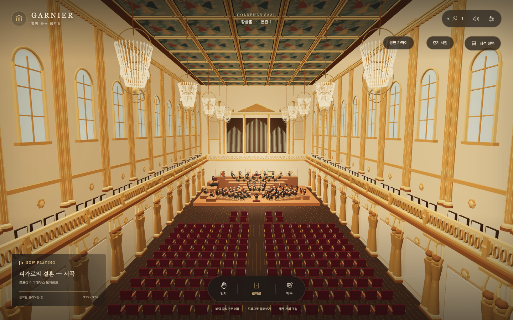

# 가르니에 — 함께 듣는 음악당

[공연장 사이트 바로 열기](https://sempark.github.io/garnier-concert-hall/)

GitHub Pages에서는 혼자 감상하는 버전으로 실행된다. 로비·공연장 이동, 착석, 인사·박수와 음원을 지원하며 다른 관객과의 실시간 접속은 서버 버전에서 제공한다. `main` 변경 시 GitHub Actions가 사이트를 자동으로 빌드·배포한다.

계획서의 핵심 흐름을 연결한 로컬 개발 버전이다. 가르니에의 로비와 무지크페라인 황금홀을 각각 참고한 공간·캐릭터·악기를 Three.js로 구성하고, 실제 Cloudflare Durable Object를 로컬에서 실행한다.



구현 계획과 진행 기록은 `docs/plans/`, 현재 화면은 `docs/screenshots/`에 있다.

## 실행

독립 실행 가능한 공연장 프로젝트다. 다른 컴퓨터에서는 GitHub 저장소를 복제한 뒤 프로젝트 폴더에서 실행한다.

```sh
git clone https://github.com/SemPark/garnier-concert-hall.git
cd garnier-concert-hall
```

Node.js와 npm이 설치되어 있어야 한다. 아래 명령으로 의존성을 설치하고 로컬 서버를 시작한다.

```sh
npm ci
npm run build
npm run dev
```

- 브라우저: http://127.0.0.1:5173/
- 로컬 서버 및 빌드된 앱: http://127.0.0.1:8787/
- `dev`는 Vite와 Wrangler를 함께 실행한다. 종료는 해당 터미널에서 Ctrl+C.
- 서버 코드는 Wrangler가, 클라이언트 코드는 Vite가 변경을 반영한다. 클라이언트 변경 시 화면이 다시 열릴 수 있다.
- 이 작업 환경에서는 Node.js 26.3.0으로 확인했다. 패키지의 실제 설치 버전은 `package-lock.json`에 고정되어 있다.

위 127.0.0.1 주소는 실행한 컴퓨터에서 접속하는 로컬 주소다. 설치 없이 감상하려면 맨 위 GitHub Pages 링크를 사용한다. 실시간 다중 접속 서버를 운영하려면 별도 서버 배포가 필요하다.

## 현재 구현

- 황금빛 로비와 무지크페라인 황금홀 형식의 직사각형 공연장. 무대 뒤 파이프오르간, 직선 발코니·상층 아치형 창, 금빛 조각상 기둥, 격자 천장·벽화, 크리스털 샹들리에 12개.
- 1층 22열 × 16석인 352석과 양옆 발코니 104석, 총 456석을 모두 선택할 수 있다. 길어진 중앙·측면 통로와 좌석 접근 경로를 함께 계산한다.
- 큰 머리·작은 몸의 남성·여성 관객과 연주자. 여성은 단발·묶은 머리와 검은 공연복으로 구분한다. 어깨·엉덩이에서만 회전하는 곧은 팔다리와 반복 동작.
- 참고 배치도의 악기 기호를 기준으로 연주자 101명 + 지휘자 1명. 현악·목관·금관·타악·하프·건반 표현.
- 폭 28 × 깊이 19.5의 밀집한 무대, 부채꼴 현악 배치와 뒤로 높아지는 단. 앞 오른쪽은 첼로, 뒤 오른쪽은 비올라, 바깥 오른쪽은 더블베이스다.
- 하프·건반에 별도 단을 두고, 작은 보면대를 옆으로 배치해 사람과 악기의 가림을 줄였다. 현악기 몸통·줄·활, 목관의 키, 금관의 관·벨·밸브를 단순한 3D 형태로 표현한다.
- 공연장 기본 시점은 뒤쪽 발코니에서 보는 황금홀 전경이다. ‘공연 가까이’ / ‘홀 전체’로 연주 확대와 건축 전경을 바꾸고, 걷기 시점으로도 전환할 수 있다.
- 인사는 양팔을 양옆으로 흔들고 박수는 앞으로 뻗어 모은다. 착석 시 무릎을 접지 않고 두 다리를 앞으로 편다.
- 바닥 클릭 이동, WASD/방향키, 드래그 회전, 휠·핀치 거리 조절.
- 장애물을 피하는 경로 탐색과 카메라 벽 충돌 처리.
- 로비/공연장 전환, 전체 좌석 456개, 좌석 예약·갱신·착석·반환·만료.
- 다른 관객의 이동·인사·박수, 끊김 후 재접속과 짧은 좌석 복구 유예.
- 서버 기준 시각에 맞춘 상시 공연, 중간 입장, 휴식, 음량·음소거·탭 복귀 처리.
- 입장에 최소 인원 조건이 없다. 한 방의 기술적 상한에 도달하면 다른 방으로 연결하는 기본 라우팅을 갖춘다. 수용 인원 상한은 서비스 검증 결과에 따라 바꿔야 한다.

## 참고 이미지의 단원 수

악기 그림 하나를 한 명으로 센다. 팀파니는 여러 북을 한 세트·한 명으로, 오른쪽 가장자리의 일부 잘린 베이스도 한 명으로 포함했다. 타악기 9종은 각각 한 명을 배치했다.

| 파트 | 인원 |
|---|---:|
| 제1 / 제2 바이올린 | 13 / 14 |
| 비올라 / 첼로 / 베이스 | 14 / 10 / 6 |
| 하프 / 피아노 / 첼레스타 | 2 / 1 / 1 |
| 목관 | 16 |
| 금관 | 15 |
| 타악 | 9 |
| 연주자 합계 / 지휘자 | 101 / 1 |

목관은 플루트 3, 피콜로 1, 오보에 2, 잉글리시 호른 2, 클라리넷 3, 베이스 클라리넷 1, 바순 3, 콘트라바순 1. 금관은 호른 6, 트럼펫 4, 트롬본 4, 튜바 1이다. 이미지에 보이는 기호 수를 따른 구성으로, 일반적인 오케스트라 정원으로 임의 교체하지 않았다. 수량·좌표·단 높이는 `src/orchestra/layout.ts`에서 관리한다.

## 조작

- 빈 바닥 클릭: 선택한 위치까지 걷기.
- ‘걷기 시점’ / ‘무대 전체’: 캐릭터 시점과 공연 관람 시점 전환.
- ‘공연 가까이’ / ‘홀 전체’: 연주 중심 확대와 황금홀 전경 전환.
- 드래그: 걷기 시점에서는 캐릭터 주변, 무대 전체에서는 정면 범위 안에서 둘러보기.
- 휠 / 두 손가락 핀치: 시점 거리 조절.
- WASD / 방향키: 현재 카메라 방향 기준 이동.
- 공연장 문 또는 입장 버튼: 구역 전환.
- ‘2층 계단’ / ‘1층 내려가기’: 뒤쪽 계단까지 걸어서 이동해 층을 바꾼다. 계단과 2층에서도 바닥 클릭·WASD를 사용할 수 있다.
- 좌석 또는 ‘좌석 선택’ 버튼: 층·열·번호를 골라 착석. 1층은 좌석 앞까지 걸어가며, 2층은 뒤쪽 계단과 발코니 통로를 따라 걸어간다. 일어나도 같은 층에 머문다. 앞쪽 좌석도 전체 객석과 같은 16석 간격으로 정렬했다.
- 걷는 동안 음악 정보는 왼쪽 위 작은 버튼으로 접힌다. 버튼을 눌러 펼치거나 접을 수 있다.
- 정적인 건축·의자는 색상별 인스턴스로 묶는다. 가까운 모델은 원래 디테일을 유지하고, 먼 모델은 단순한 지오메트리로 바꾸며 미세 장식을 생략한다. 단원 동작도 가까이에서는 20Hz, 중간 거리 10Hz, 먼 거리 4Hz로 갱신한다. 기본 픽셀 비율 1, 그림자 맵 해제, 낮은 분할 수와 공간 색인으로 GPU·충돌 검사 부담을 줄였다.
- ‘일어나기’, ESC 또는 이동 키: 좌석에서 일어나기.

탭이 숨겨지면 음악을 멈추고 돌아올 때 현재 공연 구간으로 합류한다. 브라우저가 자동 재생을 막으면 상단 소리 버튼을 누른다.

## 음원 교체

현재 곡은 모차르트 「피가로의 결혼」 서곡이다. 사용자가 지정한 Wikimedia Commons / Musopen의 CC0 음원을 MP3로 변환한 `public/audio/mozart-figaro-overture.mp3`를 사용하며 길이는 약 4분이다. 곡 종료 후 8초 쉬고 반복하며, 중간 입장자는 공통 공연 시각에 맞춰 합류한다. 설정에서 출처와 사용 조건을 확인할 수 있다. 오케스트라의 반복 동작이 음원 속 음표와 정확히 맞는 것은 아니다. 자세한 자산 기록은 `content/ASSETS.md`에 있다.

1. 음원 파일을 `public/audio/`에 넣는다.
2. `content/playlist.json`의 `tracks`에 곡명, 작곡가, URL, 실제 길이, 곡 뒤 휴식 시간을 입력한다.
3. 목록을 변경할 때 `version`과 `epochMs`를 함께 정한다. `epochMs`는 전체 반복 목록의 기준 시작 시각을 나타내는 UTC Unix 밀리초다.
4. 다시 빌드하고 실행한다. 운영 버전에서는 모든 방과 브라우저에 같은 버전이 배포되는지 확인한다.

예시:

```json
{
  "version": "concert-1",
  "epochMs": 1793314800000,
  "tracks": [{
    "id": "track-1",
    "title": "곡명",
    "composer": "작곡가",
    "url": "/api/audio/track-1.mp3",
    "durationSeconds": 600,
    "gapAfterSeconds": 8
  }]
}
```

로컬 파일을 개인 브라우저에서 열어도 다른 관객에게 공유되지는 않는다. 공통 URL에 배포한 파일을 목록에 등록해야 한다. 실제 긴 음원의 로딩·탐색 검증은 해당 파일로 다시 해야 한다.

이 앱에 넣은 음원은 `/api/audio/파일명` 경로로 요청한다. 이 경로는 `public/audio/`의 파일을 제공하면서 부분 읽기 요청을 처리한다. 큰 운영 음원은 추후 부분 읽기를 지원하는 전용 자산 저장소로 옮길 수 있다.

## 검증

```sh
npm run typegen
npm run check
npm test
npm run build
```

로컬 서버가 실행 중일 때:

```sh
npm run test:integration
```

통합 테스트는 사용자 공간과 구분한 `hall-99` 방에서 실행한다. 실제 WebSocket 접속, 좌석 경합, 접근 위치 확인, 재접속·소유권 복구, 오래된 요청의 취소, 20개 연결, HTTP Range 음원 요청을 검사한다. 연결 수 테스트는 20개 브라우저의 렌더 성능을 검증하지 않는다.

개발 서버에서만 `window.__concert`에 진단 객체를 노출한다. 운영 빌드에는 노출되지 않는다.

## 다음 검증과 남은 작업

- 실제 모바일 기기에서 전체 좌석 선택·접근 경로와 발코니 전환을 추가 검증.
- 가르니에 로비와 황금홀의 조각·벽화·몰딩, 캐릭터·악기의 외형 보완. 현재 장식은 직접 만든 단순화 모델이며 실측 조각과 벽화를 그대로 복제하지 않았다.
- 모차르트 음원의 장시간 반복 경계·탭 복귀, 추가 긴 파일의 탐색, 다른 실제 기기 사이의 오디오 동기화 측정.
- 실제 모바일의 터치 조작·프레임 속도와 관객 20명이 보이는 화면의 성능 검증.
- 좌석 예약 만료·재접속 유예의 장시간 실행 및 런타임 재시작 검증 강화.
- 자동 방 배정의 만석·동시 입장 부하 검증, 운영 로그·수용 인원 조정, 배포.

`npm run deploy`는 Cloudflare 계정에 실제 배포하는 명령이다. 이번 작업에서는 로컬 실행과 검증만 수행했다.
