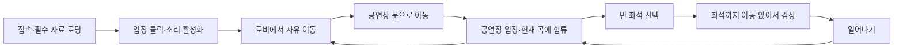
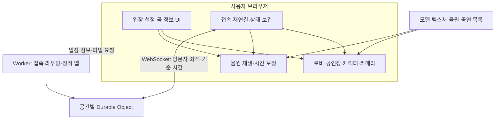

# 가르니에 온라인 클래식 공연장 — 구현 계획

작성일: 2026-10-30. 상태: 설계안(v0.2)에 따른 초기 구현 진행 중. 이후 사용자의 개발 시작 지시를 받아 `concert-hall/`에 로컬 앱을 작성했다. 현재 검증 결과와 미완료 범위는 [구현 진행 기록](progress.md)에 정리한다. 공개 배포는 아직 수행하지 않았다.

## 0. 검토 결과와 진행 원칙

이 콘텐츠는 구현 가능한 범위다. 제작 시간을 크게 좌우하는 부분은 가르니에의 장식 작업, 의자가 많은 공간의 이동·카메라 처리, 여러 브라우저의 재생 위치 복구다. 따라서 공간 전체를 먼저 꾸미기보다 최소한의 동선과 감상 경험을 끝까지 연결한 뒤 확대한다.

- 첫 검증은 단순한 로비 1개, 공연장 1개, 좌석 8개, 공통 캐릭터, 악기별 대표 연주자, 음원 1곡으로 진행한다. 이는 최종 공간 규모나 오케스트라 구성의 축소가 아니라 동작 검증 단계다.
- 다음 단계에서 두 브라우저의 입장·좌석·음악 일치를 확인한다. 이 검증을 통과한 뒤 전체 오케스트라와 가르니에 장식을 늘린다.
- 초기 다중 접속은 방 하나로 검증한다. 자동 방 배정과 다중 방 확장은 공개 준비 단계로 둔다.
- ‘하루’는 로컬에서 핵심 경험을 확인하는 목표다. 완료 여부는 아래 단계별 통과 조건으로 판단한다.
- 음악·공간·동작 설정을 코드와 분리하여 외형 수정이나 곡 교체가 접속 기능에 영향을 덜 주도록 한다.

## 1. 목표와 확정된 요구사항

누구나 로비에 들어와 돌아다니고, 원하는 순간 공연장에 입장해 다른 관객과 클래식 음악을 듣는 3D 웹 공간을 만든다.

- 공간: 사용자가 제시한 팔레 가르니에의 그랑 푸아예와 공연장. 긴 황금빛 로비, 반복되는 기둥·아치, 천장화, 샹들리에, 붉은 객석, 다층 발코니와 무대 프레임을 핵심으로 삼는다.
- 표현: 산사 수준의 단순하고 귀여운 캐릭터. 앞서 생성한 이미지의 렌더 품질을 납품 기준으로 삼지 않는다.
- 조작: 산사처럼 캐릭터 뒤의 3인칭 시점, 바닥 클릭 이동, 드래그 회전, 휠 거리 조절. WASD/방향키와 모바일 핀치도 같은 입력 체계에 연결한다.
- 추가 지시 반영: 공연장은 3번째 공연 사진을 기준으로 밀집한 무대와 정면 상단 관람 시점을 기본으로 제공한다. ‘걷기 시점’으로 기존 3인칭 조작을 선택할 수 있다. 여성 캐릭터를 포함하고, 첼로·비올라·더블베이스 구역과 악기 외형을 구분한다. 하프·건반의 별도 단과 옆으로 비킨 보면대로 가림을 줄인다.
- 최신 내부 지시 반영: 로비는 가르니에를 유지하고 메인 공연장·객석은 무지크페라인 황금홀을 기준으로 한다. 긴 직사각형, 양옆 직선 발코니, 파이프오르간, 아치형 창, 금빛 조각 기둥과 격자 천장·크리스털 샹들리에를 구현한다. 기본 전경과 공연 확대를 별도로 제공한다.
- 입장: 정원 충족이나 최소 인원 조건 없이 계속 입장한다. 관객 수가 공연 시작을 결정하지 않는다.
- 공연: 3D 오케스트라를 배치하고 악기별로 단순한 반복 동작을 재생한다. 음악은 사용자가 준비한다.
- 개발 방식: 확인한 산사의 공개 클라이언트 구현 방식을 참고하여 읽기 쉬운 별도 코드로 작성한다.

### 계획을 구체화하기 위한 제안 기본값

다음은 아직 사용자가 개별 확정하지 않은 구현 기본안이다. 설정으로 바꿀 수 있도록 만든다.

| 항목 | 제안 기본값 |
|---|---|
| 공연 운영 | 공통 재생 목록을 계속 반복하는 상시 공연 |
| 중간 입장 | 현재 곡의 현재 구간부터 참여 |
| 사용자 식별 | 로그인 없이 임시 방문자, 자동 이름·캐릭터 색상 |
| 감상 | 빈 좌석 선택 → 이동 → 앉기, 언제든 일어나기 |
| 좌석 시점 | 같은 드래그·휠 조작 유지, 앉은 높이로 부드럽게 이동 |
| 상층 발코니 | 첫 버전은 관람 배경으로 구현, 이동은 로비와 1층 객석 |
| 소통 | 작은 인사·박수 동작. 텍스트 채팅은 후속 기능 |
| 곡 사이 | 설정 가능한 짧은 휴식, 기본 8초 |
| 소리 | 공연장에서 음악 재생, 로비로 나가면 짧게 페이드아웃 |
| 첫 검증 범위 | PC 우선, 20명 동시 접속을 초기 검증 목표로 설정 |

20명은 성능을 확인하기 위한 목표이며 입장 대기 조건이나 검증된 수용 한도가 아니다.

## 2. 사용자 흐름



- 로비와 공연장은 한 방문 세션 안의 두 구역이다. 구역을 옮겨도 접속을 다시 만들지 않는다.
- 음악은 브라우저의 소리 활성화에 성공한 뒤 재생한다. 입장 클릭으로 활성화를 시도하고, 실패하면 작은 ‘소리 켜기’ 버튼을 보여준다.
- 관객은 공연장 통로를 걸을 수 있다. 좌석·벽·무대를 통과하지 않도록 이동 가능한 영역을 정의한다.
- 무대는 관람용이다. 초기 버전의 이동 범위는 로비와 공연장 1층이다. 상층 발코니는 시각 구조로 먼저 구현한다.
- 좌석을 선택하면 서버가 우선 확보하고, 이동에 실패하거나 취소하면 반환한다. 앉은 상태의 이동 입력은 먼저 일어나기로 처리한다.
- 좌석 상태는 `비어 있음 → 이동 중 예약 → 착석`으로 나눈다. 이동 중 예약에는 만료 시간을 두고, 실제 도착 후 착석을 확정한다. 긴 이동 중 예약 갱신, 예약 만료, 다른 좌석 선택도 처리한다. 재접속 유예는 별도의 만료 규칙으로 관리한다.
- 접속이 끊기면 재연결 상태를 표시하고 서버 상태와 음악 위치를 다시 맞춘다.

### 이동과 카메라 구현 기준

- 바닥을 클릭해도 직선으로 의자를 관통하지 않도록 이동 가능한 영역과 경로 탐색을 둔다. 처음에는 고정 배치에 맞는 격자 또는 통로 그래프를 사용한다.
- 모든 좌석에 접근 지점과 마지막 착석 경로를 정의한다. 예약을 받기 전에 도달 가능 여부를 확인하고, 배치 변경 뒤에도 통로 폭을 검증한다.
- 클릭·드래그·핀치를 구분하고 UI 위에서 발생한 입력은 공간 이동으로 전달하지 않는다. 모바일에서는 작은 좌석도 선택할 수 있도록 선택 판정 범위를 조정한다.
- 카메라와 캐릭터 사이의 벽·기둥을 검사해 카메라 거리를 줄인다. 상하 각도와 거리를 제한하고, 앉았을 때 내 캐릭터 머리가 무대를 가리지 않게 한다.
- 로비와 공연장 사이에는 명시적인 출입 구간을 둔다. 전환 중 중복 입장이나 잘못된 위치 전송을 막고 도착 위치를 서버와 맞춘다.

## 3. 가르니에를 만드는 방식

첫 단계에서는 사진에서 드러나는 주요 비례와 공간 구성을 맞춘다. 정확한 실측 복원에는 추가 도면·사진이 필요하므로, 치수를 확인한 것처럼 가정하지 않는다.

| 공간 | 보존할 특징 | 제작 방법 |
|---|---|---|
| 로비 | 길고 높은 중앙 공간, 양쪽 기둥과 창·거울, 반복되는 천장 구획 | 기둥·아치·창문 모듈을 반복 배치 |
| 공연장 | 객석을 감싸는 곡선 발코니, 붉은 좌석과 커튼, 금색 무대 프레임 | 곡선 구간 모듈, 반복 좌석, 단순화한 금색 몰딩 |
| 천장·벽 장식 | 넓은 면의 회화와 금색 장식 | 확보한 사용 가능한 텍스처와 얕은 입체 장식 조합 |
| 샹들리에 | 큰 실루엣과 따뜻한 빛 | 단순한 중심축·링·전구 반복, 발광 재질 중심 |

가까이 보는 문·좌석·기둥에는 입체감을 주고, 높은 천장과 먼 발코니의 세부 조각은 텍스처로 표현한다. 모든 전구에 실시간 조명을 넣지 않고 공간별 소수의 조명으로 분위기를 만든다.

첫 외형 검토 기준은 ‘로비와 공연장이 가르니에를 연상시키는가’, ‘산사처럼 캐릭터가 공간 안에 자연스럽게 들어가는가’, ‘객석에서 무대가 잘 보이는가’다.

장식 작업 전에 단순한 공간에서도 로비의 긴 비례와 공연장의 발코니·무대 구도가 읽히는지 확인한다. 천장화·조각·거울의 세부 재현은 기본 이동과 감상 기능이 통과된 뒤 적용한다. 필요한 텍스처·모델은 자산 목록에 출처와 사용 조건을 기록하고, 산사 자료의 공개 배포 여부를 우리 앱에서 재사용 가능한 조건으로 간주하지 않는다.

## 4. 캐릭터와 오케스트라

2026-10-30 추가 지시: 팔다리는 팔꿈치·무릎 없이 한 덩어리로 유지한다. 인사는 양옆으로 흔들고, 박수는 앞으로 뻗은 손을 모으며, 착석 시 다리를 앞으로 곧게 편다. 오케스트라는 제공한 부채꼴 악기 배치도를 따르고 뒤쪽 단원을 위해 단을 높인다. 배치도 기준 인원은 제1바이올린 13, 제2바이올린 14, 비올라 14, 첼로 10, 베이스 6, 하프 2, 목관 16, 금관 15, 타악 9, 건반 2명이다. 팀파니는 한 세트당 한 명으로 센다.

- 공통 캐릭터 구조 하나를 관객·연주자·지휘자에 사용한다. 큰 둥근 머리, 짧은 몸과 팔다리, 간단한 머리 모양과 의상으로 구성한다.
- 첫 구현은 구·단순 몸체·어깨와 엉덩이 회전 그룹으로 직접 구성할 수 있게 하여 외부 모델 확보에 개발 시작이 묶이지 않게 한다. 이후 GLB 모델로 교체해도 입력·동작 인터페이스는 유지한다.
- 관객 동작: 대기, 걷기, 앉기, 일어나기, 인사, 박수.
- 최종 첫 버전의 무대 목표: 사용자 제공 배치도에 맞춘 연주자 102명과 지휘자 1명 (2026-10-31 호른 아이콘 재집계 반영). 현악·목관·금관·타악·하프·건반을 배치하고, 공간이 부족하면 무대를 확장한다. 초기 동작 검증은 각 유형 1명으로 한다.
- 반복 동작: 현악 활 왕복, 관악기 고정 자세와 작은 몸 흔들림, 타악기 팔 움직임, 지휘자 팔 움직임. 첼로·더블베이스 등은 악기 위치와 손 위치를 별도로 조정한다.
- 악기마다 손가락과 음표까지 동기화하지 않는다. 곡 시작·종료·휴식 때 연주/대기 상태를 맞춘다. 이는 이번 버전에서 합의가 필요한 표현상의 한계다.
- 연주자는 서버에 접속하는 사용자가 아니다. 공통 공연 시간과 캐릭터별 고정 위상값으로 각 기기에서 동작을 계산한다.
- 머리·의상·악기는 공통 기본형의 변형으로 제작한다. 악기와 손의 접점이 어색하지 않도록 동작 범위를 작게 잡는다.
- 관절 이름과 회전축·손의 부착 지점을 공통 캐릭터 규격으로 정한다. 캐릭터 모델 교체는 이 규격과 동작을 함께 검증하며, GLB 교체만으로 기존 동작이 자동 호환된다고 가정하지 않는다.
- 현악·관악·타악·지휘 동작을 각각 한 명으로 검증한 뒤 복제한다. 102명의 배치와 지휘자, 실제 동시 관객을 합친 상태에서 성능을 확인한다.

## 5. 시스템 구조

제안 기술: TypeScript + Vite, Three.js, 작은 React UI, Cloudflare Worker + Durable Objects. React는 메뉴와 곡 정보 등 화면 UI를 담당하고, 3D 프레임 갱신은 Three.js 쪽에서 처리한다.



### 브라우저가 맡는 일

3D 렌더링, 내 캐릭터의 즉각적인 조작, 클릭 지점 판정, 경로 이동, 카메라 보간, 다른 관객의 움직임 보간, 연주자 반복 동작, 음원 로딩과 재생을 맡는다.

### 서버가 맡는 일

방문자 ID 발급, 입퇴장, 구역·위치·자세 공유, 좌석 소유권, 공연 기준 시간과 재생 목록 버전 전달, 재연결 시 전체 상태 복구를 맡는다. 음악 데이터나 매 프레임의 관절 각도를 WebSocket으로 보내지 않는다.

### 접속 규모

처음에는 하나의 로비와 공연장을 한 Durable Object로 관리한다. 수용 인원이 늘면 동일한 공간 인스턴스를 추가한다. 인원이 다 차야 공연을 시작하는 구조는 없다.

상시 입장은 입장 인원을 기다리지 않는다는 의미다. 한 방의 동시 접속 수에 상한을 없앤다는 의미로 구현하지 않는다. 첫 다중 접속 검증에서는 방 하나의 오류·성능을 확인하고, 공개 버전에서는 초과 인원을 다른 방으로 안내한다.

공개 운영 전에는 빈 방 선택과 입장 확정을 원자적으로 처리하는 방 배정 계층을 추가한다. 방 목록의 인원 숫자만 믿고 입장시키지 않고, 대상 방에서 최종 수용 여부를 확인한다. 모든 방은 동일한 공연 목록 버전과 기준 시각을 공유한다.

서버의 WebSocket Hibernation을 활용할 경우 연결별 상태를 복원할 수 있게 저장한다. 좌석 소유권·재접속 유예와 공연 설정은 필요 수명에 맞게 보존하고, 매 프레임 위치를 영구 데이터베이스에 기록하지 않는다. 실제 서버 원본이 없는 산사의 서버 구조를 그대로 확인했다고 간주하지 않는다.

음악 진행을 알리기 위한 서버의 상시 반복 타이머는 두지 않는다. 클라이언트가 공통 시간표에서 현재 구간을 계산하게 하여 관객이 앉아 있을 때도 불필요한 메시지와 서버 작업이 계속 발생하지 않게 한다.

## 6. 음악 재생 구조

`공연 목록 버전 + 기준 시작 시각 + 각 곡 길이 + 곡 사이 휴식`으로 현재 곡과 재생 위치를 계산한다.

1. 서버와 시간 차이를 추정한다. 왕복 요청의 시간을 기록하고 여러 표본 중 지연이 작은 값을 활용한다.
2. 서버 기준 현재 시각에서 공연 시작 시각을 빼고 전체 목록 길이로 순환시킨다.
3. 해당 구간이 곡이면 곡 ID와 곡 내부 재생 시간을 구한다. 휴식이면 남은 휴식 시간을 구한다.
4. 음원의 메타데이터와 재생 준비가 끝난 시점에 현재 위치를 다시 계산한 뒤 재생한다.
5. 중간 입장, 버퍼링 복구, 탭 복귀, 네트워크 재연결 때 시간을 다시 맞춘다.
6. 정상 재생 중에는 허용 오차를 두고 점검한다. 작은 오차마다 강제 탐색해 음악이 튀지 않게 한다.

점검 시에는 계산된 목표 위치와 실제 `audio.currentTime`을 비교한다. 경과 시간 추정에는 단조 증가 시계를 활용하고 재연결 때 서버 시간 차이를 다시 구한다. 버퍼링 중에는 재생 중인 것처럼 표시하지 않으며, 복구된 시점의 목표 위치로 합류한다. 탭 복귀·음소거 해제 뒤에도 현재 공연 위치를 기준으로 복구한다.

음원은 파일 서버에서 각 브라우저로 전달한다. 긴 곡의 중간 구간을 빠르게 열 수 있도록 HTTP Range 요청, 파일 형식, 캐시·CORS를 검증한다. 초기 로컬 개발에서는 프로젝트 음원 경로를 사용하고, 배포 시 큰 음원·모델 파일은 별도 자산 저장소/CDN에 둔다.

초기 설정 예시: `playlist.json`에 `version`, `epochMs`, `tracks[{id,title,composer,url,durationSeconds,gapAfterSeconds}]`를 둔다. 곡 길이는 실제 파일에서 확인한다. 목록 교체는 새 버전과 적용 시각을 함께 배포하여 접속자마다 다른 곡이 나오지 않게 한다.

사용자가 아직 음원을 제공하지 않은 상태다. 구조와 시각 동작은 먼저 개발할 수 있고, 실제 공연 재생 검증에는 음원 파일·곡명·순서가 필요하다.

첫 오디오 검증은 짧은 임시 음원 1개로 진행할 수 있지만, 긴 클래식 음원의 탐색·로딩 검증은 실제 파일로 별도 수행한다. 개인 브라우저에서 선택한 로컬 파일은 다른 관객에게 자동 공유되지 않는다. 함께 듣는 음원은 공통 URL로 배포하고 공연 목록에 등록한다. 초기 곡 교체는 파일과 설정 수정으로 처리하고 업로드·관리자 화면은 후속 기능으로 둔다.

## 7. 상태와 통신 계약

| 데이터 | 핵심 필드 | 책임 |
|---|---|---|
| 방문자 | id, sessionId, name, appearance, zone, position, yaw, pose, seatId | 서버가 식별·좌석을 확정하고 위치를 검증 |
| 좌석 | id, position, facing, approachPoint, occupantId, reservationExpiry | 서버가 중복 점유 방지 |
| 공연 | playlistVersion, epochMs, manifestUrl, serverNow | 같은 공연 시간 제공 |
| 방 | roomId, sceneVersion, capacity, revision | 접속 상태와 버전 관리 |

- 클라이언트 → 서버: `join`, `move`, `changeZone`, `reserveSeat`, `releaseSeat`, `gesture`, `sync`, `clockPing`.
- 서버 → 클라이언트: `welcome`, `snapshot`, `delta`, `seatResult`, `clockPong`, `error`.
- 메시지 크기·빈도, 위치 범위, 세션 소유권을 검사한다. 좌석 취득은 중복 요청에도 결과가 일관되게 처리한다.
- 이동은 초기 2~5회/초 전송 범위에서 실측 조정하고 화면은 보간한다. 멈춤·착석·퇴장 이벤트는 즉시 전송한다.
- 상태 버전이 빠지면 전체 상태를 다시 받는다. 재접속한 세션과 이전 연결의 정리 이벤트가 충돌하지 않게 연결 세대를 구분한다.
- 좌석 재접속 유예는 짧게 둔다. 만료 시 반환하며 서버 재시작·절전 복귀 뒤에도 점유 상태를 복구한다.
- 같은 브라우저의 복수 탭도 별도 연결로 식별한다. 이전 연결의 종료 메시지가 새 연결의 좌석을 반환하지 않도록 세션과 연결 세대를 함께 확인한다.
- 정상 착석 위치와 현재 구역은 서버가 확인한다. 클라이언트의 위치 전송만으로 좌석 소유권이 바뀌지 않게 한다.

## 8. 코드 구조 제안

현재 상위 작업 폴더는 Remotion 농구 영상 프로젝트다. 실제 앱은 별도 `concert-hall/` 폴더에 구성했다. 아래는 책임별 목표 구조이며, 초기 버전의 장면 통합과 UI 진입점은 각각 `src/World.ts`, `src/main.tsx`에 있다. 현재 실행 방법은 앱의 `README.md`를 참고한다.

```text
concert-hall/
  src/
    app/                 # 시작·정리·로딩 상태
    ui/                  # 입장, 설정, 곡 정보, 소리 버튼
    scene/
      lobby/             # 로비 모듈 배치
      auditorium/        # 객석·발코니·무대
      materials/         # 공통 재질·조명
    character/           # 공통 몸체·외형·관절·동작
    controls/            # 클릭·드래그 구분, 이동, 카메라
    navigation/          # 이동 영역, 경로, 장애물, 출입구
    orchestra/           # 악기, 단원 배치, 반복 동작
    audio/               # 시간 계산, 파일 재생, 동기화
    network/             # WebSocket, 재연결, 상태 보간
  server/
    worker.ts            # HTTP·WebSocket 접속 라우팅
    VenueRoom.ts         # 방문자·좌석·구역 상태
  shared/                # 프로토콜, 좌석·공간 설정, 공연 시간 계산
  content/               # 공연 목록, 모델·텍스처 목록
  public/                # 초기 로딩에 필요한 작은 정적 자산
  tests/                 # 시간 계산·좌석·복구·핵심 사용자 흐름
```

## 9. 구현 순서와 완료 조건

| 단계 | 작업 | 완료 조건 |
|---|---|---|
| 0. 기본 골격 | 별도 앱, 렌더러, 로딩 화면, 오류 표시 | 로컬 브라우저에서 빈 3D 공간을 안정적으로 실행 |
| 1. 조작 검증 | 단순 캐릭터, 산사식 이동·카메라, 클릭/드래그 구분 | 목표 지점 이동, 벽 충돌, 카메라 회전·거리 조절이 편안함 |
| 2. 공간과 좌석 | 단순 로비·공연장, 문 전환, 통로, 검증용 좌석 8개 | 로비 → 공연장 → 좌석 → 로비를 왕복하고 의자·벽을 관통하지 않음 |
| 3. 공연 검증 | 악기별 1명, 동작 루프, 음원 1개와 시간 계산 | 재생 준비가 늦어져도 현재 위치로 합류하고 곡 끝에서 동작도 멈춤 |
| 4. 함께 감상 | 방 하나의 실제 WebSocket 서버, 관객·좌석 공유, 재연결 | 두 브라우저에서 서로 보이고 좌석 동시 선택·만료·복귀를 처리하며 같은 곡 구간을 재생 |
| 5. 가르니에 외형 | 기둥·발코니·커튼·금색 장식·천장·조명, 전체 오케스트라 | 참고 사진의 핵심 공간 구성이 읽히고 무대가 잘 보임 |
| 6. 공개 준비 | 실제 음원, 자산 최적화, 모바일 입력, 부하·오디오 검증, 방 배정 | 초기 목표 인원과 대상 기기에서 검증 통과 후 배포 |

첫 작업일의 우선 목표는 단계 0~3의 ‘걸어 들어가 앉아서 공연을 듣는 로컬 버전’이다. 자산 준비와 구현 진행에 따라 두 브라우저 접속까지 이어간다. 하루 만에 가르니에 외형·다중 접속 안정성·모바일 최적화가 모두 끝난다고 약속하지 않는다. 정식 첫 버전의 범위는 단계 6까지다.

각 단계에서 실행 화면과 완료 조건을 확인하고 다음 단계로 넘어간다. 특히 단계 4 통과 전에는 장식 자산을 대량 제작하거나 다중 방 배정으로 범위를 넓히지 않는다. 사용자가 확인할 중간 결과는 ① 조작 가능한 캐릭터, ② 입장·착석 가능한 공간, ③ 혼자 감상 가능한 공연, ④ 두 명이 함께 감상하는 공연, ⑤ 가르니에 외형을 갖춘 전체 장면이다.

## 10. 성능과 검증 계획

- 초기 목표: 대표 PC에서 조작 중 60fps 지향, 전체 무대와 목표 관객을 표시해도 30fps 미만으로 지속 하락하지 않도록 검증. 이는 측정 전 목표이며 성능 보장이 아니다.
- 좌석·기둥·악보대 등 동일한 정적 구조는 인스턴싱·공유 재질을 활용한다. 여러 스켈레톤 캐릭터를 정적 인스턴싱으로 해결할 수 있다고 가정하지 않는다.
- 가까운 관객과 먼 관객의 상세도·동작 갱신 빈도를 나눈다. 보이지 않는 구역은 렌더링을 줄이고 필요한 자산만 먼저 로딩한다.
- 연주자·샹들리에마다 그림자용 광원을 추가하지 않는다. 픽셀 비율과 그림자 품질에 상한을 둔다.
- 시간 계산 테스트: 곡 경계·휴식 경계·목록 순환·시계 오차·목록 버전 변경.
- 서버 테스트: 같은 좌석을 동시에 선택, 중복 요청, 끊김 후 복귀, 유예 만료, 서버 상태 복구, 구역 전환.
- 실제 브라우저 검증: 클릭과 드래그 혼동, 의자 사이 길찾기, 확대 시 벽 침투, 착석 시 내 머리가 무대를 가리는 현상.
- 오디오 검증: 두 기기 중간 입장, 느린 로딩, 탭 복귀, 모바일 소리 활성화. 초기 동기화 목표는 안정 구간에서 재생 위치 차이 0.5초 이내이며 샘플 단위 동기화를 보장하지 않는다.
- 초기 부하 검증: 20개 접속의 상태 공유와 실제 렌더 성능을 별도로 측정한다. 서버 연결 테스트만으로 20명 렌더 성능을 통과 처리하지 않는다.
- 자산 교체 뒤 회귀 확인: 캐릭터 발이 바닥에 닿는지, 손과 악기가 맞는지, 좌석 접근 경로가 유지되는지, 카메라 충돌이 없는지 다시 확인한다.
- 공개 전에는 사용한 기기·화면 크기·관객 및 연주자 수·프레임 속도·음원 로딩 시간·동기화 오차를 기록한다. 이 기록을 보고 방 수용 인원과 기본 화질을 정한다.

### 개발 착수 전 준비할 입력

| 입력 | 준비 시점 | 없을 때의 진행 방법 |
|---|---|---|
| 가르니에 참고 사진 | 공간 배치 검토 | 현재 첨부 사진의 주요 비례로 시작, 상세 복원은 추가 사진 후 조정 |
| 음원·곡명·순서 | 실제 음악 검증 | 구조·캐릭터·동선은 먼저 검증, 임시 음원은 별도로 표시 |
| 대표 PC·모바일 기기 | 성능 목표 확정 | 우선 개발 기기에서 수치를 기록하고 대상 기기에서 재검증 |
| 배포 계정·도메인 | 공개 준비 | 로컬 미리보기와 다중 브라우저 검증을 먼저 진행 |

## 11. 후속 기능

상층 객석 이동, 정교한 악기별 연주 타이밍, 의상 편집, 텍스트 채팅, 공연 일정 예약, 관리자 웹 화면, 포토 모드, 사실적인 조각·거울 반사는 핵심 감상 흐름이 완성된 뒤 추가한다.

## 12. 참고 자료

- 사용자 첨부: 팔레 가르니에 공연장·그랑 푸아예 사진. 공간과 분위기의 기준.
- [산사](https://sansatemple.com/) 및 [확인한 공개 클라이언트 번들](https://sansatemple.com/assets/game-D9JTEbm0.js). 브라우저에 공개된 구현만 확인했으며 서버 원본은 확인하지 않았다.
- [Three.js 문서](https://threejs.org/docs/): 렌더러·장면·카메라·모델 구성 참고.
- [Cloudflare Workers Static Assets](https://developers.cloudflare.com/workers/static-assets/): 앱 파일과 API를 배포하는 경로.
- [Durable Objects WebSockets](https://developers.cloudflare.com/durable-objects/best-practices/websockets/): 방 단위 연결과 Hibernation 상태 복원 참고.
